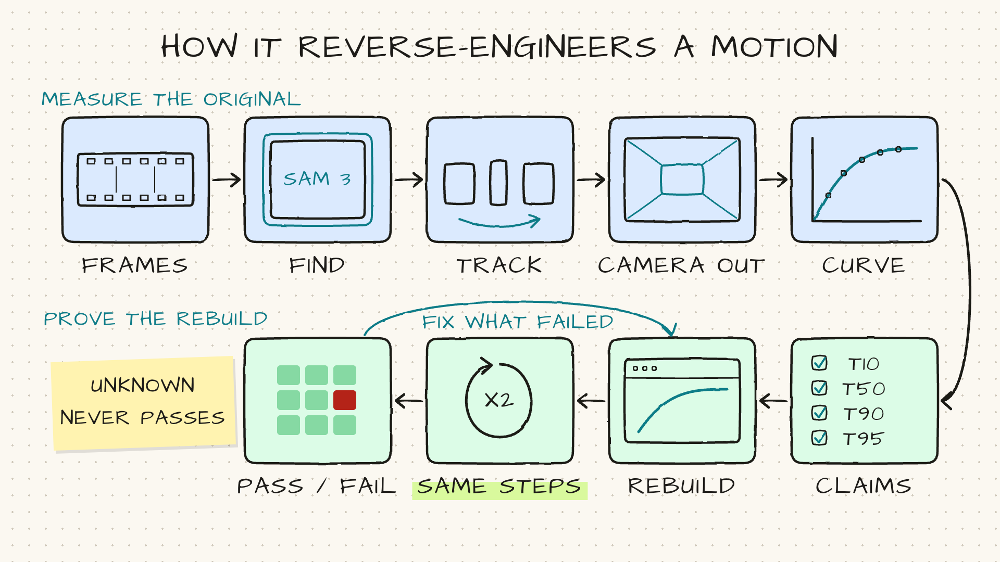
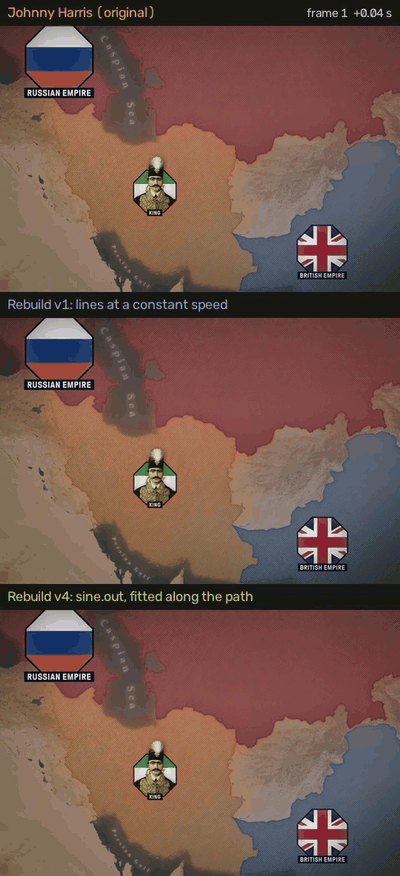

# REM: Reverse Engineer Motion

Measure how the animation in any video actually moves, rebuild it, and prove your rebuild moves the same way.

It's an agent skill (Claude Code, Codex, Cursor and anything else that reads `SKILL.md`) plus a Python CLI. Point it
at a few seconds of a YouTube, Instagram or TikTok video. It finds every element in every frame, tracks it, measures
when it starts, slows and stops, fits the ease curve, and writes down claims you can test. Then it measures your
rebuild with the same code and fails it, claim by claim, wherever the timing is off.


*Top: Johnny Harris's original. Bottom: a rebuild made only from the numbers this tool measured. [The full worked example](examples/johnny-harris/) shows every command, every number and every rebuild version. Footage
credit and rights: [About the footage](examples/johnny-harris/#about-the-footage).*

## Why

My library of creator effects was first rebuilt from screenshots and written notes, and the rebuilds kept coming out
wrong without anything flagging it. Entrances ran 2-4x too slow. A card deck the notes had as "dealt in from the right" was actually a fast flip-in
from the left, one card every 0.075 s. A map's connector lines looked linear; my linear rebuild landed 4 frames late,
and the measurement showed they ease out (`sine.out`).

Eyeballing can't catch that. Measuring both sides with the same code can.

## How it works



```
video window ──► masks per frame ──► tracks ──► camera removed ──► quantities over time
 (yt-dlp,         (SAM 3 on fal,      (linking,   (register every   (position, size, a line's
  ffmpeg,          or your render's    stitching,  frame to frame 0) draw-on length, a glow's
  native fps)      alpha, locally)     groups)                       brightness...)
                                                                          │
           recipe.json ◄── claims (t10/t50/t90, overshoot, ◄── ease fit (GSAP power, sine,
           for builders     stagger, start/end, ease)          expo, circ; BIC picks a winner
                                                               or says unknown)
                                   │
                 replay the same steps on your rebuild ──► compare: pass/fail per claim
```

The rules it holds itself to:

- Every number says whether it was **observed** (read off pixels), **derived** (fitted) or **inferred** (a judgement).
- Claims are only made on what's visible. An ease name counts only when its fit clearly beats the next family.
- Missing data is `unknown`, and `unknown` never passes.
- An effect is "learned" only when a render of the rebuild passes every claim.

## Install

You need **[uv](https://docs.astral.sh/uv/)** (it installs Python 3.10+ and the packages for you), **ffmpeg**, and,
for URLs, **yt-dlp**. Built and tested on macOS; Linux should work the same way; Windows is untested. On a Mac:

```bash
brew install uv ffmpeg yt-dlp
```

Then add the skill to your agent. Pick one:

**Claude Code plugin**

```
/plugin marketplace add sidart10/rem
/plugin install rem@rem
```

**Any agent, with the skills CLI**

```bash
npx skills add sidart10/rem
```

**By hand**

```bash
git clone https://github.com/sidart10/rem
cp -r rem/skills/reverse-engineer-motion ~/.claude/skills/
```

Check the setup and run the self-test (a synthetic clip with a known ease, the whole proof loop, no network, free):

```bash
cd skills/reverse-engineer-motion        # or wherever the skill landed
uv run scripts/doctor.py
uv run scripts/motion_re.py --self-test
```

### The fal key (only for SAM 3)

Finding elements in someone else's video uses Meta's **SAM 3** through **[fal](https://fal.ai)**, at about
**$0.005 per frame per prompt**. A typical effect is 40-90 frames, so roughly $0.20-$1.40. Create a key at
https://fal.ai/dashboard/keys and:

```bash
export FAL_KEY=your-key
```

Everything else (frames, tracking, camera, line and glow measuring, fitting, claims, and masks from your own renders'
alpha channel) runs on your machine for free.

## Use it

Ask your agent in plain words:

> Reverse-engineer the card flip at 0:04-0:05 in https://www.instagram.com/p/... and tell me the timing and easing.

> Here's my rebuild (rebuild.mov, transparent background). Check it against the original, claim by claim.

Or drive the CLI yourself:

```bash
mre() { uv run scripts/motion_re.py "$@"; }
S=studies/2026-10-creator; E=$S/motion/01-card-flip
mre window https://youtu.be/... --study $S --effect 01-card-flip --t0 4.03 --t1 5.38
mre mask $E --prompt card --frames 12,24      # try a prompt on 2 frames first
mre mask $E --prompt card                     # then every frame
mre run $E                                    # measure + link + a contact sheet of the tracks
mre track $E --name card --near 300,500 --fields cx,cy,w
mre fit $E card.cx && mre claims $E
mre recipe $E                                 # recipe.json for your builder
```

The full walkthrough, including measuring thin lines and glows that SAM can't see, and proving a rebuild, is in
[`skills/reverse-engineer-motion/SKILL.md`](skills/reverse-engineer-motion/SKILL.md).

To watch an original and your rebuilds frame-locked, with labels and a frame counter:

```bash
uv run scripts/side_by_side.py $E $S/motion/01-card-flip-rebuild-v1 --out compare.mp4 --gif compare.gif --stills 24
```

## Worked example

[`examples/johnny-harris/`](examples/johnny-harris/) takes three effects from one Johnny Harris video all the way
through: the prompts that worked and the ones that didn't, the exact commands, the measured numbers, every rebuild
version and what its comparison caught, and the claim-by-claim result.

**Why measure.** The middle row moves its lines at a constant speed and looked right. Measured, it was 4 frames late
at the halfway point. The original eases out (`sine.out`), and the bottom row, built from the fitted curve, lands
within about a frame.



## Guardrails

- **Public footage only goes to the cloud.** A clip is sent to fal only when it came from a public URL (or you pass
  `--public-url` for a file you downloaded from one). Anything under `~/Pictures`, `~/Movies`, `/Volumes` or a folder
  in `MOTION_RE_PRIVATE_DIRS` is refused. Measure your own renders with `mask --alpha`, locally.
- **Spend caps.** $10 per study and $40 per month by default (`references/budget.json`). A run is priced in full and
  refused in full before anything is sent; every call is logged (`~/.motion-re/spend.jsonl`).
- **Creators' pixels stay out of git.** Media, frames and masks live in `raw/` folders the tool git-ignores. The
  numbers, claims and recipes are yours to keep.

Study effects to learn the craft. Don't republish someone's footage, and credit the creator when their technique
teaches you something.

## What works, what doesn't yet

Tested on a storyboard-deck effect (41 frames, $0.30: every card tracked, including edge-on frames) and three Johnny
Harris effects ([worked example](examples/johnny-harris/)): a map with badges and beaded lines over a camera push (84
frames, $1.36: matched a hand measurement within a frame; the rebuild passes 26 of 29 claims), a torn-paper quote card
and a badge that builds, jumps and ripples (both measured locally, $0).

- **Not yet:** 3D perspective (rotateX/Y, tilt), so flips are measured in 2D only.
- **SAM 3 misses thin, half-drawn lines.** Measure those locally with `pixels --path-auto`.
- **SAM 3.1's video mode** (`fal-ai/sam-3-1/video-rle`) didn't propagate masks in testing (3 of 41 frames), so this
  masks each frame and links them.
- It has been tuned on a handful of effects. Issues and examples of effects it gets wrong are very welcome.

## Credits

- SAM 3 by Meta, served by [fal](https://fal.ai/models/fal-ai/sam-3/image). Use of SAM 3 is subject to Meta's SAM
  License and fal's terms.
- [OpenCV](https://opencv.org), [NumPy](https://numpy.org), [SciPy](https://scipy.org), [FFmpeg](https://ffmpeg.org),
  [yt-dlp](https://github.com/yt-dlp/yt-dlp)
- Ease families named after [GSAP](https://gsap.com)'s (power, sine, expo, circ), so a recipe drops straight into a
  GSAP or [HyperFrames](https://github.com/heygen-com/hyperframes) build. GSAP is a Webflow product; this project
  isn't affiliated with it, and doesn't include or call it.
- The observed/derived/inferred proof ledger is inspired by [REA](https://github.com/morluto/rea)

Made by [Sid Dani](https://github.com/sidart10). MIT licensed.
