# Worked example: three Johnny Harris map effects

Three effects from one Johnny Harris video, ["The REAL reason the US can't beat Iran"](https://www.youtube.com/watch?v=-DDbYSg0Alw),
measured with this tool and rebuilt in [HyperFrames](https://github.com/heygen-com/hyperframes). Each rebuild was
rendered, measured by the same code, and compared claim by claim. Every number on this page comes from those runs;
the raw files are in [`data/`](data/).

| Effect | What it is | Frames | Cloud cost | Rebuild |
|---|---|---|---|---|
| [A. Badge pulse + connector lines](#a-badge-pulse--connector-lines) | a badge glows red, two beaded lines draw out to other badges, the map pushes in | 84 | $1.36 | v6 passes 26 of 29 claims |
| [B. Torn-paper quote card](#b-torn-paper-quote-card) | a quote card uncovered through ink drips while the text types on, over a zoom | 180 | $0 | v6 lands the reveal on the frame at t10 and t50 |
| [E. Badge build, jump and rings](#e-badge-build-jump-and-rings) | a badge assembles from parts, jumps 2.5x in one frame, then sends out three rings | 120 | $0 | v10 jumps 2.125 s against his 2.127 s |

The comparison videos and stills are made with [`side_by_side.py`](../../skills/reverse-engineer-motion/scripts/side_by_side.py),
which plays the original's window and each rebuild frame-locked: frame k in every row is the frame the tool measured.

In the commands below, `mre` is `uv run skills/reverse-engineer-motion/scripts/motion_re.py`, `$S` is the study
folder (`studies/2026-10-johnny-harris`) and `$E` is the effect folder (`$S/motion/01-badge-connectors`).

---

## A. Badge pulse + connector lines

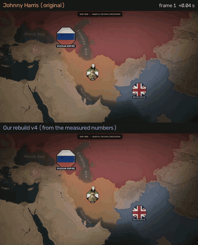

[Full-quality video](media/a-original-vs-rebuild.mp4) (full speed, then half speed) · [Still at frame 48](media/a-original-vs-rebuild-f048.png)

4:28.9 to 4:32.4 in the video, 84 frames at 23.976 fps. A red glow blooms behind the Shah's badge. At the glow's
peak, two beaded rope lines sprout from it and draw out to the Russian and British badges, while the whole map
pushes in.

### 1. Cut the window

```bash
mre window https://www.youtube.com/watch?v=-DDbYSg0Alw --study studies/2026-10-johnny-harris \
    --effect 01-badge-connectors --t0 268.9 --t1 272.4
```

### 2. Find the elements (SAM 3 on fal)

Prompts were tried on 2 frames each ($0.01) before running any on all 84. Only three earned a full run:

| Prompt | Result |
|---|---|
| `octagon` | the badges, but drops whole runs of frames on its own |
| `flag` | the badges too; together with `octagon` they hold the British badge on 80 of 84 frames |
| `dotted line` | the lines, but only once they are nearly drawn (frame 55 on) |
| `badge`, `emblem`, `sticker`, `red glow`, `dashed line`, `line`, colour-named lines | nothing useful |

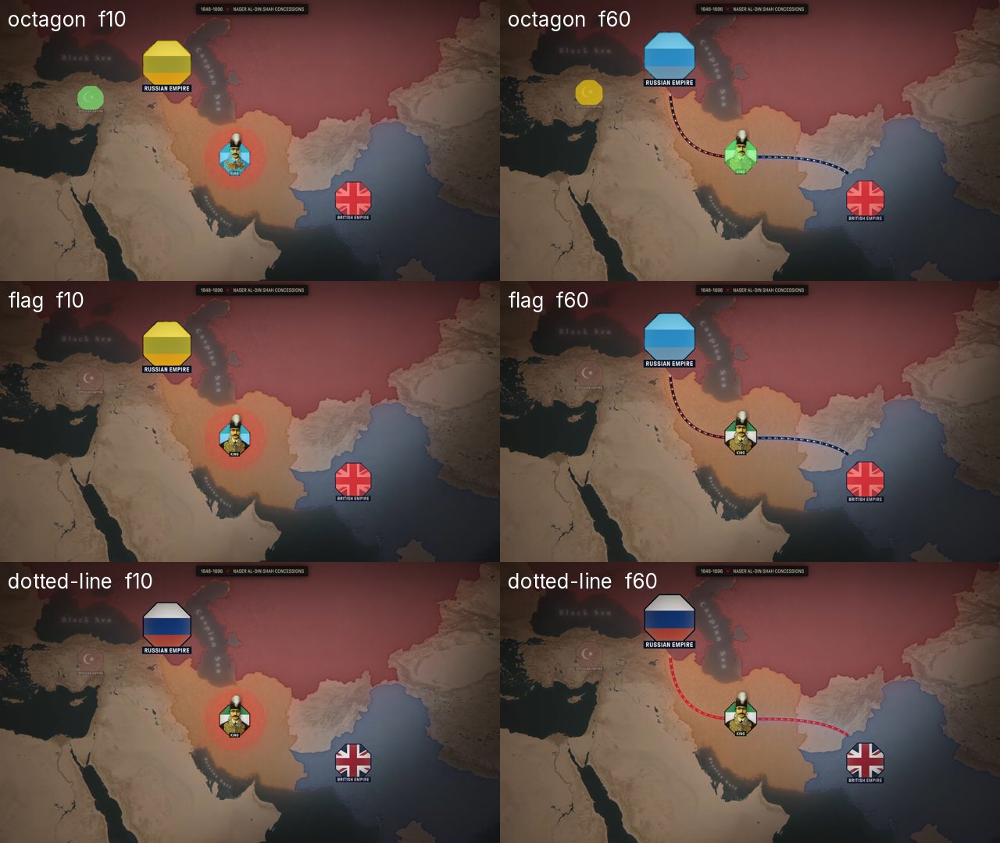

```bash
mre mask $E --prompt octagon --frames 10,60      # try first: $0.01
mre mask $E --prompt octagon                     # then all 84 frames: $0.42
mre mask $E --prompt flag
mre mask $E --prompt "dotted line"
mre run $E                                       # measure + link + the tracks sheet
```

Total cloud spend for the study: **$1.36**. The tracks sheet shows every element's track in its own colour, frame by
frame; check it before trusting a number.

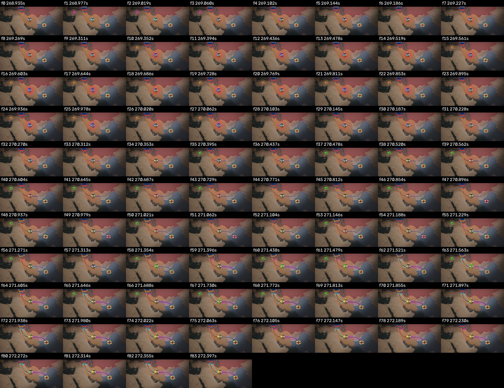

### 3. Measure what moves

These are the exact recorded steps (`effect.json` keeps them as `pipeline`, so `replay` can run them again on a
rebuild). The full list is in [`data/a-pipeline.json`](data/a-pipeline.json).

```bash
# the camera: register every frame to frame 0 through two badges that sit still on the map
mre camera $E --anchors 640,240 1370,764
mre fit $E camera.scale
# the lines: SAM can't see them while they draw, so they're measured from pixels, along their own path
mre pixels $E --name line-left --rule "luma<60" --rule "dluma<-40" --within-source sam3-dotted-line \
    --not-source sam3-octagon --not-pad 2 --open 3 --path-auto 898,609 --toward 640,240 --skip 138 --origin 74 --bridge 40
mre pixels $E --name line-right ... --toward 1370,764     # same rules, toward the British badge
mre fit $E line-left.drawn ; mre fit $E line-right.drawn
# the glow: how red a ring around the badge gets, frame by frame
mre pixels $E --name pulse --value red --rule "dluma>-40" --ring 898,609,65,136 --not-source sam3-octagon
mre fit $E pulse.mean --pulse
mre claims $E
```

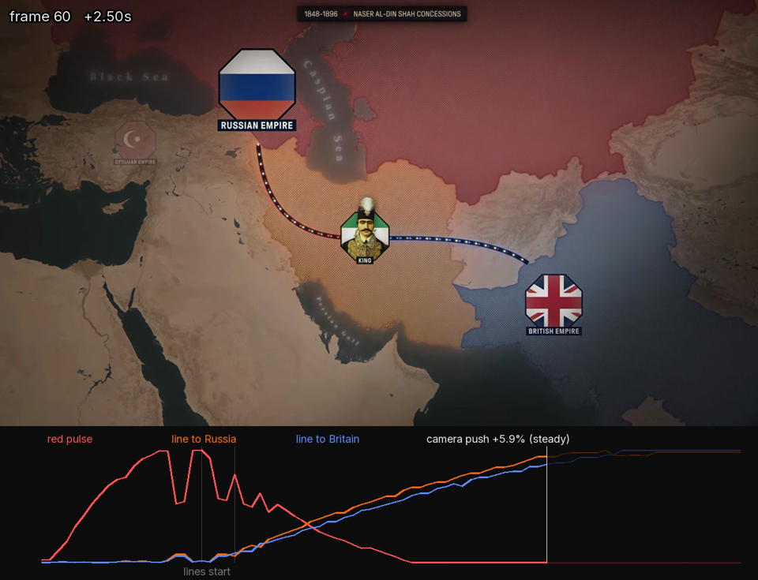

[Video with the curves drawn under the picture](media/a-measured.mp4)

What came out:

| Move | Measured | Basis |
|---|---|---|
| Camera | a steady push, 1.000 to 1.086 over the window (2.49% a second), no ease | derived from the two badge tracks |
| Glow | half-way up at 0.31 s, peak at 0.79 s, half-way down at 1.25 s | observed (a ring's mean red) |
| Left line (to Russia) | `sine.out` from 0.897 to 3.024 s, 346 px along its path; beats the next ease family by a BIC gap of 61 | derived |
| Right line (to Britain) | `sine.out` from 0.897 to 3.149 s, 370 px; BIC gap 51 | derived |
| Beads | about 23 px apart | observed by hand, kept in the recipe's `manual` block |

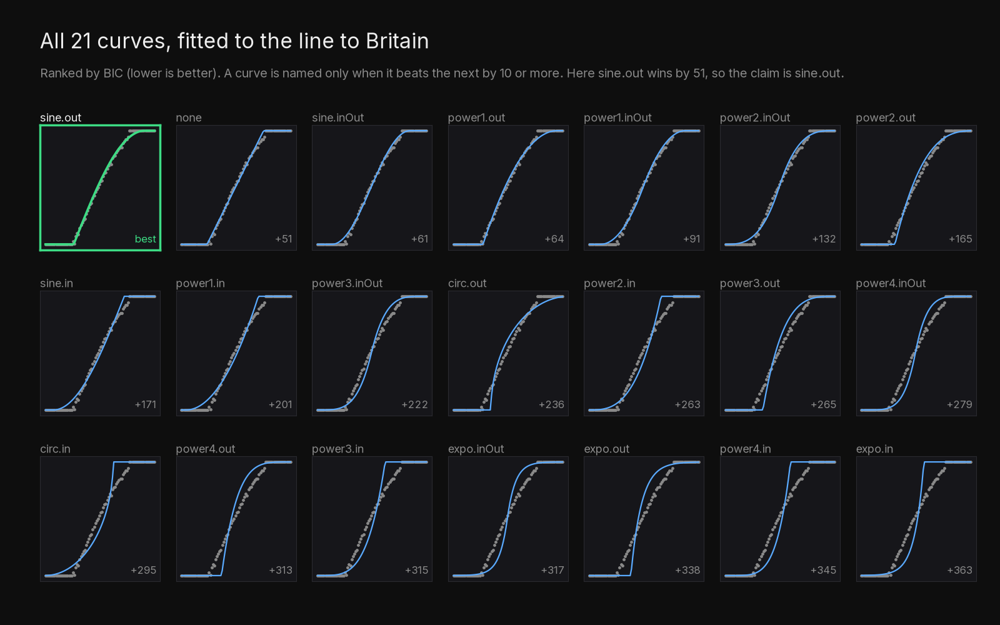

### 4. Rebuild it, then measure the rebuild the same way

The rebuild uses his frame 0 as the background plate, so only the motion is being tested. The camera push, the
glow and both lines are built in HyperFrames from the measured numbers, rendered with a transparent background per
layer, then measured with the same steps:

```bash
mre window renders/a-rebuild-v6-comp.mp4 --study $S --effect 01-badge-connectors-rebuild-v6 --t0 0 --t1 3.5035
mre mask $S/motion/01-badge-connectors-rebuild-v6 --alpha renders/a-rebuild-v6-badges.mov --name badges   # free, local
mre mask $S/motion/01-badge-connectors-rebuild-v6 --alpha renders/a-rebuild-v6-lines.mov --name lines
mre run $S/motion/01-badge-connectors-rebuild-v6
mre replay $E --on $S/motion/01-badge-connectors-rebuild-v6 --map sam3-octagon=alpha-badges --map sam3-dotted-line=alpha-lines
mre compare $E $S/motion/01-badge-connectors-rebuild-v6
```

Each version fixed what the previous comparison failed:

| Version | Change | Result against his |
|---|---|---|
| v1 | lines at a constant speed | lines 4 frames late at the halfway point |
| v2 | an ease-out from a straight-line fit | glow matches; lines 0.1-0.2 s early |
| v3 | fitted start and end times | right line matches to halfway; left line 7 frames early at t90 (the fit bent on the curved path) |
| v4 | ease fitted along the path: `sine.out` on both | 15 of 16 timing checkpoints within about 1 frame |
| v5 | times read from `recipe.json`, rope eased edge to edge | 22 of 29 claims: part of the path sits under the badge, so the visible rope ran fast |
| v6 | the rope tip driven in the recipe's own units (px from the measuring origin) | **26 of 29 claims** |

The lesson as numbers: the line to Britain over time. v1 reaches the halfway point 4.4 frames late (fail, and its
curve fits as `none`, constant speed); v4 is 0.8 frames early (pass).

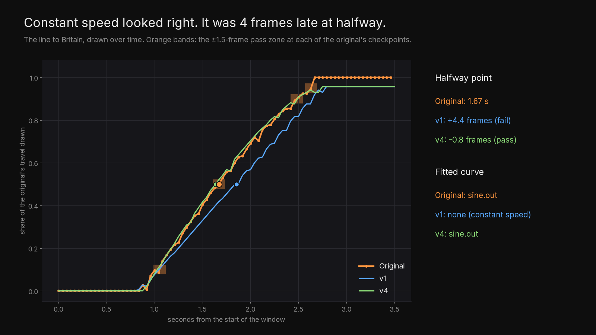

And in one picture, at frame 40:

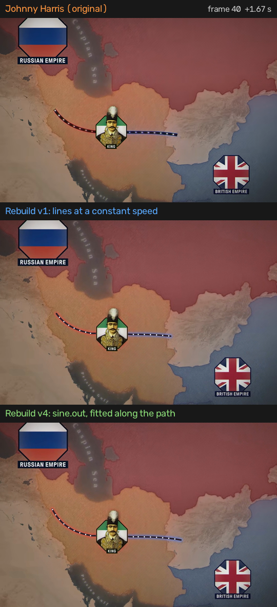

[Animated](media/a-linear-vs-eased.gif) · [Video](media/a-linear-vs-eased.mp4) · [Still at frame 48](media/a-linear-vs-eased-f048.png)

### 5. The claims, one by one (v6)

From [`data/a-compare-v6.json`](data/a-compare-v6.json). Times are seconds from the window's first frame.

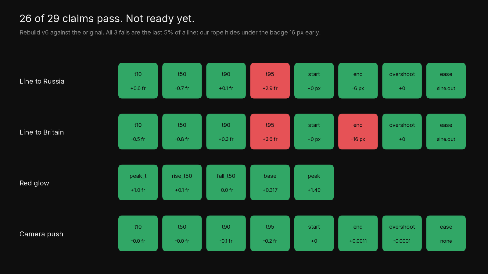

| Claim | His | Ours | Off by | Result |
|---|---|---|---|---|
| left line t10 / t50 / t90 | 0.996 / 1.635 / 2.387 | 1.019 / 1.607 / 2.390 | under 1 frame each | pass |
| left line t95 | 2.558 | 2.678 | 2.9 frames | **fail** |
| left line end, overshoot, ease | 346 px, 0, sine.out | 340 px, 0, sine.out | 6 px | pass |
| right line t10 / t50 / t90 | 1.053 / 1.672 / 2.482 | 1.031 / 1.637 / 2.496 | under 1 frame each | pass |
| right line t95 | 2.631 | 2.781 | 3.6 frames | **fail** |
| right line end | 370 px | 354 px | 16 px | **fail** |
| glow peak / half-up / half-down | 0.792 / 0.312 / 1.251 | 0.833 / 0.318 / 1.250 | 1 frame or less | pass |
| camera t10 to t95, start, end, ease | 1.001 to 1.085, none | 1.001 to 1.086, none | under 0.2 frames | pass |

The 3 failures share one cause: the last 5% of each line. Our rope disappears under the badge's cut-out 16 px before
his does. That's a plate mask, not timing, but it still fails, so the effect isn't marked `ready`. A v7 would let the
rope run over the badge edge as his does.

### 6. Hand it to a builder

[`data/a-recipe.json`](data/a-recipe.json) is what a builder reads instead of copying numbers: each move's ease and
times, the glow's keyframes, the camera rate, the hand-measured bead spacing, and `ready: false` until a rebuild
passes everything.

---

## B. Torn-paper quote card

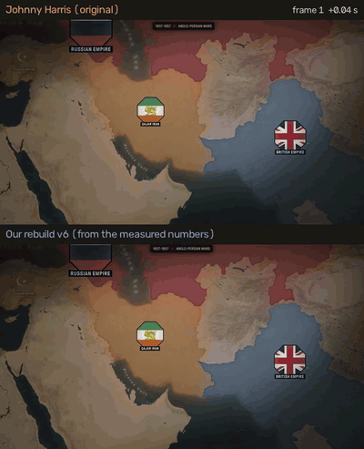

[Full-quality video](media/b-original-vs-rebuild.mp4) · [Still at frame 30](media/b-original-vs-rebuild-f030.png)

4:03.9 to 4:11.4, 180 frames. Measured entirely on the Mac: the dark red card, the white text and the map separate
cleanly by colour, so no cloud masks were needed ($0).

| Part | Measured |
|---|---|
| Camera | one `power2.out` zoom and pan over 3.9 s (scale 1 to 1.415), then a `power1.in` push-in from 3.5 s |
| Ink reveal | card uncovered t10 0.75 s, t50 1.08 s, t90 1.71 s; tall vertical drips, up to 19 at once; an ease-out, family `unknown` (the out-eases fit within a few BIC points of each other) |
| Typing | constant speed, about 205 px/s; each letter flicks on, then keeps brightening for about a second |

| Version | Change | Result against his |
|---|---|---|
| v1 | zoom, ink and typing by first guess | card reveal matches; typing 0.3-0.4 s late |
| v2 | constant-speed typing, 1 s letter fade | typing head within about 25 px |
| v3 | pan and zoom as two moves | worse: that split came from a drifting camera measure |
| v4 | camera registered straight to frame 0: one move plus a push | camera within 0.3% |
| v5 | 1.4 s letter fade, brighter text | line 2 half-bright 5 frames early |
| v6 | ink stretched vertically into drips | reveal t10 and t50 on the frame; 20 drips against his 19 |

The v3 mistake is a rule now: register every frame straight to frame 0. Chaining frame to frame split one camera move
into two. Re-registered both ways for the figure below, the chain ends 2.6% short (1.417 against 1.454) and misses the
slow push-in at the end entirely; registered to frame 0, the scale matches the hand measurement.

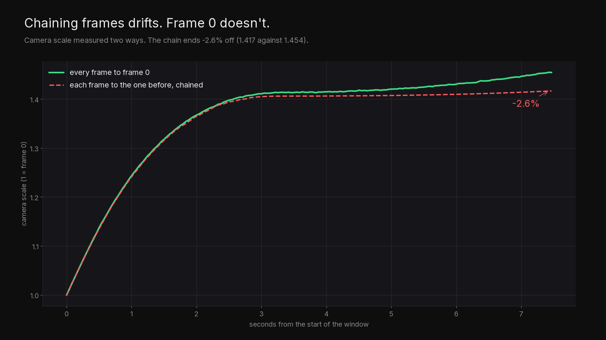

---

## E. Badge build, jump and rings

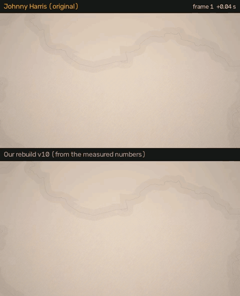

[Full-quality video](media/e-original-vs-rebuild.mp4) · [Still at frame 40](media/e-original-vs-rebuild-f040.png)

31:16.3 to 31:21.3, 120 frames, measured locally ($0). The label opens sideways from a line, the hanger's tip rises,
the head rises and docks, then the whole badge jumps to 2.5x its height in a single frame and sends out three gold
rings.

| Part | Measured |
|---|---|
| Label | opens from 3 px to 281 px wide, 0.54 to 2.04 s, `power1.inOut`; its top edge never moves |
| Hanger tip | rises `power2.out` 0.61 to 2.13 s (BIC gap 40) |
| Head | rises `power2.out` 0.93 to 2.69 s |
| Jump | one frame at 2.127 s, to 2.55x taller |
| Rings | three, born about 2.71, 3.05 and 3.27 s, each growing and fading over about 0.35-0.4 s |

| Version | Change | Result against his |
|---|---|---|
| v1-v3 | everything zooming about the label | wrong structure: his label never scales |
| v4 | label opens in place, tip and head on their fitted curves | structure matches |
| v5-v9 | string, label and ring looks; jump found once the badge settles | label within 3-9 px, tip within 1-3 px, rings within about 10 px |
| v10 | jump on its frame | jump 2.125 s against his 2.127 s; push 3.5% against 3.4% |

The v1-v3 mistake is a rule now: look at the structure at full size before fitting. A letter-height yardstick said
"everything zooms"; the frames showed only the hanger and head grow.

---

## About the footage

The clips and frames on this page are a few seconds from Johnny Harris's
["The REAL reason the US can't beat Iran"](https://www.youtube.com/watch?v=-DDbYSg0Alw), shown next to our rebuilds
to explain and test how the motion works. All credit for the original design and animation goes to Johnny Harris and
his team. If you're the rights holder and want any of it removed, open an issue and it will come down.
